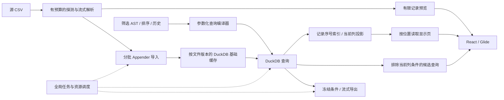

# 本地大型 CSV 查看与筛选工具：架构与实施约定

日期：2026-11-18。状态：设计基线。实施状态与真实测量另见 `implementation-status.zh-CN.md`、`benchmarks.zh-CN.md`。

版本说明：本文保留 0.1.0 只读阶段的原始设计约定。0.2.0 已加入会话级编辑、行列删除、颜色及 CSV 另存为；这些行为以 `implementation-status.zh-CN.md`、`versioning.zh-CN.md` 和 `CHANGELOG.md` 为准。原始数据缓存仍保持不可变。

本文承接本次用户需求，后续开发应遵循其中的功能、正确性与资源约束。本文性能表中的数字为设计目标；实际结果必须以独立测试记录为准。

## 1. 需求理解与推荐技术路线

首版面向 Windows 10/11 x64、本地 SSD、16GB RAM，覆盖 1GB、5GB、10GB 文件及同时打开 5 个 2GB 文件。定位为只读查看、筛选、排序、复制、导出；不包含编辑、公式、实时追尾、跨文件连接查询。

推荐：

> Tauri 2 + Rust + React 18 + TypeScript + Glide Data Grid + 原生嵌入式 DuckDB；有预算的流式 CSV 解析；每个文件版本一份磁盘基础缓存；每个当前查询一份记录序号索引和按需列投影；前端只保留少量显示页。

不使用 DuckDB WASM，不把 CSV 传入 WebView，不在首屏前统计全量行数、全量类型或全文件哈希，不以当前屏幕的数据生成候选值。

### 依赖基线

以下为经公开发行资料核对的候选稳定版本，不代表已经完成 Windows 集成编译。P0 必须用最小可运行样例完成兼容性验证，再提交 Cargo.lock、前端 lockfile 与工具链文件。

| 部分 | 基线 | 选择依据 |
| --- | --- | --- |
| Rust | 1.100.0，x86_64-pc-windows-msvc | 2026-11-12 发布的稳定工具链；只用 stable |
| Tauri Rust | 2.12.6 | 已发布稳定版 |
| Tauri JS API / CLI | 2.12.5 / 2.12.5 | 同一 2.12 发布系列；不同包补丁号不强行相同 |
| DuckDB | 2.0.0 | 原生磁盘分析引擎；缓存版本与引擎版本绑定 |
| duckdb-rs | =1.20000.2，bundled | 其版本编码对应 DuckDB 2.0.0；使用随 crate 构建的引擎；不启用 beta 的 duckdb-neo |
| React / React DOM | 18.3.1 / 18.3.1 | Glide 6.0.3 的 peer 范围包含 React 18；首版不强行使用 React 19 |
| Glide Data Grid | 6.0.3 | 成熟 Canvas 按需绘制及表格交互 |
| TypeScript | 5.9.3 | 保守稳定基线，避开不必要的编译器大版本迁移 |
| Vite / React 插件 | 8.x 稳定补丁 / 6.x 稳定补丁 | Node 24 LTS 构建环境；P0 锁定精确补丁，不使用 beta/nightly |
| CSV | csv-core 0.1.13；csv 1.x 锁定补丁用于写出 | 同一成熟解析体系；受控输出缓冲可实施记录长度限制 |
| 编码 | encoding_rs 0.8.44 | 明确采用 WHATWG GBK/GB18030 映射及无替换错误处理 |
| 批数据 | DuckDB 对应的 Rust Arrow 版本 + Arrow IPC | Rust 侧避免引入两套 Arrow 大版本；JS 只接收经过兼容测试的 IPC 子集 |
| 其他 | Tokio、Serde、BLAKE3，P0 锁定稳定补丁 | 调度、协议、流式内容校验；不引入第二个查询引擎 |

Node、Vite、Rust/C++ 编译器仅用于开发构建，不是用户运行依赖。具体发布包必须经过锁文件构建、peer 检查、Windows MSVC 编译、IPC 往返、取消和安装测试；不能仅凭版本号声称已经兼容。

DuckDB 仅启用实际需要的 bundled/Arrow 接入功能，不启用 extensions-full、Polars 或网络文件访问；关闭运行时扩展自动安装/自动加载。发行包包含正常功能所需的一切本地能力，不在查询期间下载扩展。Rust Arrow 与 JS Arrow 约定使用普通 UTF-8 字符串、uint64 等经过往返验证的 IPC 类型，不依赖未经验证的新 Arrow view 类型。

### Windows 部署

默认 NSIS 安装包，使用系统 Evergreen WebView2；安装器检测缺失运行时。提供携带 WebView2 离线安装器的离线分发包，保证断网机器也能安装。正常运行只加载本地前端和本地数据，不需要网络。

不默认捆绑 Fixed Version WebView2。离线安装器与 Fixed Runtime 的额外成本分别统计，不能用 Tauri 空壳体积宣传最终程序体积。Evergreen 运行时本身的系统更新行为不等于本应用需要联网查询数据。

## 2. 关键取舍与资源成本

### 组件比较

| 方案 | 大文件与内存 | 安装部署 | Excel 式交互 | 开发维护结论 |
| --- | --- | --- | --- | --- |
| Tauri + React + Glide + DuckDB | 解析与查询在原生侧；可落盘；仍有 WebView 与 DuckDB 成本 | 不随应用重复携带 Chromium，但需要 WebView2 | Glide 提供选区、列布局和 Canvas 绘制；联动筛选由本应用实现 | 推荐 |
| Electron + 同一查询后端 | 查询性能可能相近；浏览器与 Node 常驻资源需要实测 | 自带 Chromium、运行时版本可控，分发成本更高 | 同样容易复用 React 表格 | 不为首版增加部署成本 |
| Rust + egui/Slint 等原生 UI | 有降低浏览器成本的可能，整应用内存仍需实测 | 无 WebView2 依赖；引入各自运行库和布局成本 | 高密度表格、输入法、剪贴板、选区、冻结列需更多适配 | 仅在实测证明 WebView 成本不可接受后评估 |
| DOM 表格 + 通用虚拟列表 | 大宽表的 DOM 和组件成本更难控制 | JS 部分可能较小 | 大量表格细节仍需实现 | 不优先替换 Glide |
| SQLite | 磁盘查询与点取成熟；大量无索引 DISTINCT、全表分析需实测 | 有减少原生库成本的可能 | 与绘制层无关 | P0 可作为基准，不同时维护两套正式引擎 |
| Polars | 擅长列式计算，但本方案仍需补持久缓存、查询生命周期及结果分页 | 需要重新核算依赖与二进制成本 | 与绘制层无关 | 首版不替代 DuckDB |

比较是工程判断，不是已测得的定量结论。保留成熟解析器、数据库和表格组件，不同时自研三套基础设施。

### 全局预算

以下为 16GB 机器的初始配置，全部按整个应用分配，不按标签页复制：

| 资源 | 初值及行为 |
| --- | --- |
| DuckDB memory_limit | 全局 2GiB；不能视为整个进程或进程树的硬上限 |
| DuckDB threads | min(4, 可用逻辑核心数) |
| 重任务 | 全局 1 个：导入、完整筛选/排序、候选集合构建、导出共享名额 |
| 轻任务 | 最多 2 个小规模页读取/预览；不能绕过重任务准入执行全表 SQL |
| 解析与批队列 | 总预算 128MiB；有界队列与背压 |
| 后端页/编码缓冲 | 总预算 128MiB |
| 前端数据页 | 全局 64MiB；后台标签通常释放页，只保留视图状态 |
| 历史 | 每标签最多 100 个确认操作、8MiB；全局 32MiB，先到者生效 |
| 应用磁盘缓存 | 默认总计 64GiB：基础 32、结果/候选 16、引擎临时 16；各项为分区预算，受总上限约束 |
| 磁盘安全余量 | 保留 max(4GiB, 缓存卷容量的 5%)；导出目标卷单独检查 |
| 整应用内存目标 | 常规单任务进程树 Private Bytes 峰值不超过 3.5GiB；五标签场景不超过 4GiB，待测 |

进程树内存统计包含主进程和本应用关联的所有 WebView2 renderer、browser、GPU、utility 子进程。报告 Private Bytes、私有工作集与工作集；工作集求和可能重复计算共享页，虚拟地址空间大小不作为实际占用。

监测压力后先减小页、停预取、释放后台投影，再暂停后台导入。DuckDB 某些分配在 memory_limit 之外，因此该配置只是一层控制；原生分配失败必须转为可恢复错误。首版不承诺操作系统级内存硬隔离。

### 磁盘副本原则

基础数据只保存一套原文字段 DuckDB 表，不同时保存全量转码 CSV、Parquet、Arrow 原表与 DuckDB 原表。

当前查询保存有明确用途的结果索引与当前可见列投影。未筛选、未排序的默认视图直接读基础表，不创建第二份全表。筛选或排序恰好命中全部记录且显示全部列时，结果投影确实可能接近另一份数据大小；这是可测量、受预算限制、可淘汰的分页成本，不能宣传为只有几个字节的缓存。

## 3. 模块与数据流



| 模块 | 责任与边界 |
| --- | --- |
| desktop_shell / ipc | 窗口、文件对话框、本地能力限制、命令和二进制页协议 |
| session_manager | 标签、文件句柄、版本与关闭生命周期 |
| csv_ingest | 探测、固定 ParseSpec、受控解析、诊断、预览和 Appender 批导入 |
| database_host | 全局 DuckDB 实例、连接工作线程、ATTACH/DETACH、内存和临时目录 |
| filter_domain | 结构化条件、类型解释、规范化、条件摘要；不操作表格数据副本 |
| query_compiler | 可信内部列标识映射和参数绑定；不接受前端 SQL |
| query_service | 全文件结果生成、稳定排序、结果索引、计数 |
| candidate_service | 排除自身列条件的去重、全局搜索、分页、计数 |
| result_store | Arrow IPC 分块文件、记录序号文件、位置清单、投影版本和 LRU |
| history_service | 后端权威的轻量状态历史与分支 |
| task_scheduler | 全局准入、优先级、背压、取消、旧任务淘汰 |
| cache_manager | 版本校验、磁盘配额、原子发布、崩溃残留回收 |
| export_service | 冻结导出规范、流式写出、进度、禁止覆盖、成功发布 |
| frontend | 标签、筛选菜单草稿、同步 getCellContent 访问页缓存、列布局与状态显示 |
| diagnostics / benchmark | 阶段耗时、全进程树内存、磁盘占用、正确性校验 |

采用单进程内嵌数据库，不启动数据库服务器。一个应用级 DuckDB database instance 加有限连接；各就绪文件缓存只读 ATTACH，当前导入缓存可写 ATTACH。一次导入事务只写一个目标数据库。所有连接共享全局预算，不按文件分别 open 一套独立引擎实例。

数据库连接由专用工作线程拥有，Statement 不跨线程共享。Tokio 负责控制流，不在异步执行器线程直接执行长时间阻塞的数据库调用。P0 必须验证 ATTACH、流式结果、Appender、interrupt 和全局配置作用域。

## 4. 核心状态与不可变语义

以下为接口级模型，不是完整实现代码：

```text
TabSession {
  tab_id, file_id, source_path, dataset_revision,
  lifecycle, parse_spec, schema,
  desired_view: ViewState,
  state_revision, current_query?,
  layout, viewport_anchor, selection_anchor,
  history, task_handles
}

ParseSpec {
  encoding, encoding_mapping_version,
  delimiter, quote, double_quote,
  header_mode, trim_policy: Preserve,
  blank_line_policy, field_count_policy: RejectMismatch,
  max_raw_record_bytes, max_decoded_record_bytes,
  max_field_bytes, max_columns,
  parser_dialect_version
}

ColumnMeta {
  column_id, source_ordinal, sql_name,
  original_header, display_header, interpretation?
}

ViewState {
  filters: Map<ColumnId, ColumnFilter>,
  sort: SortKey[]
}

ColumnFilter {
  value_selection: ValueSelection?,
  predicates: Predicate[]
}

ValueSelection {
  default_selected: bool,
  search_rules: Ordered<MatchRule>,
  point_overrides: Map<ValueKey, bool>
}

ValueKey =
  InlineText(small_text) |
  ValueRef(dataset_revision, column_id, representative_rid, digest, byte_length)

Predicate =
  Equals | NotEquals | Contains | NotContains |
  NumericRange(DecimalSpec, bounds) |
  DateTimeRange(DateTimeSpec, bounds) |
  IsEmpty | IsNotEmpty

QueryResult {
  query_id, dataset_revision, state_revision,
  projection_revision, state,
  generated_rows, exact_total?,
  rid_index, projection_manifest,
  order_spec, resource_lease
}

CandidateSession {
  menu_id, column_id, context_fingerprint,
  base_state_revision, draft_selection,
  search_revision, search_spec,
  candidate_handle?, selected_unavailable,
  exact_distinct_count?
}

History {
  past: ViewStateRef[], present: ViewStateRef, future: ViewStateRef[],
  action_limit, byte_limit
}
```

布局、滚动、选区是每标签状态，不属于首版筛选/排序撤销范围。历史只引用筛选和排序状态，使用不可变结构共享，不引用或复制结果数据页。超过预算时淘汰最旧历史并更新按钮状态，不增加隐含后台副本。

### 筛选数学定义

设完整、已就绪的数据为 D，每列条件为 Pc：

```text
表格结果 R = { r ∈ D | AND_c Pc(r[c]) }
当前列 c 的候选 Cc = DISTINCT {
  r[c] | r ∈ D AND AND_(j != c) Pj(r[j])
}
```

跨列 AND，同列候选勾选 OR。同一列同时配置值选择与高级条件时取 AND，菜单明确显示组合。当前列候选查询排除该列整个 ColumnFilter，包括其高级条件，不能只排除其中的勾选项。

结果使用所有有效条件；候选使用完整基础数据和其他列条件；排序和当前结果分页不参与候选上下文。禁止在当前结果页上做 DISTINCT，也禁止删减数据副本代替保存条件。

示例：

| 已应用条件 | 表格结果 | 打开 B 的候选 |
| --- | --- | --- |
| A=小区1 | 小区1/1，小区1/5 | 1、5 |
| A=小区1 且 B=1 | 小区1/1 | 仍为 1、5 |
| 清除 A，保留 B=1 | 从完整 D 计算所有 B=1 的行 | 不受 A 限制 |

B 选择 1 和 5 时，条件为 A=小区1 AND (B=1 OR B=5)。再打开 C，候选由 A、B 的条件共同限定。

### 高唯一值选择

1. 全选：default_selected=true，无排除项；语义等于该列无值限制。
2. 全不选：default_selected=false，无包含项；语义为 FALSE，保留零结果。
3. 全选后排除少数：default_selected=true，加少量 false overrides。
4. 只勾少数：default_selected=false，加少量 true overrides。
5. 选择当前页：仅为独立、明确标注的批量点选动作，不能代替全选。
6. 全选搜索命中：添加搜索 MatchRule，不枚举命中的数百万个值。

搜索规则使用“后匹配的规则覆盖先前规则”，最后应用逐值 overrides。新增批量选择/取消规则时，先移除其匹配范围内旧的逐值覆盖，以保证最后一次用户动作生效；之后的逐值动作再覆盖规则。全选/全不选会重置此前规则；复杂度上限例如 64 条规则、10,000 个显式值、单菜单 4MiB，超限时引导用高级条件，不能扩展到无界内存。

“全选搜索命中”的首版语义是动态值规则：它覆盖后端完整候选上下文中所有搜索命中，而非当前页；以后其他列条件放宽时，新出现且满足该搜索规则的值也入选。按钮旁明确标注该语义。全选整体同样是动态全集。首版不提供“冻结当时数百万个候选值快照”的模式。

菜单搜索只影响展示；只有显式点击“全选搜索命中”才把搜索规则加入草稿，且点击“确定”后才生效。普通搜索、逐次勾选不创建历史。

当其他列条件变化，已有明确选中值即使不可用也保留，显示“已选、当前上下文无匹配”；规则型选择显示当前可用匹配计数或“计数中”，不枚举所有不可用值。清空搜索和翻页都不清空草稿。

### 原文、空值与类型

- 每个原始字段保存为 VARCHAR，不先推断和重写。IMSI、IP、前导零编号、超过 JS 安全整数范围的数字以及时间戳均保持文本。
- `_source_rid` 使用显式 UBIGINT，数据逻辑记录从 1 起，不使用 DuckDB 内部 rowid 作为长期身份；有表头时表头不计入数据序号。
- 列身份由缓存内稳定 ColumnId 标识，SQL 列名如 c_0001；重复表头可显示“名称 [2]”，原始表头另存。空表头显示“列 N”。无表头文件从第一条完整记录确定列数。
- `,,` 与 `,"",` 都表示存在但长度为零的文本；空白字符串保留空格，不等于空字段；字面量 NULL/NA 不自动转空。
- 首版“空值”明确指长度为零的字段，“非空值”指长度大于零；不自动 trim。
- 缺失字段和多余字段默认作为列数错误，定位后停止，不能悄悄补 NULL 或跳过记录。首版不提供自动补齐，以避免 CSV 无法无歧义区分 NULL 与空文本的回写问题。
- 完全空白物理行按固定方言忽略，不是逻辑记录；该政策展示在解析配置中，不把包含空格的行当成空白行丢弃。
- 默认文本比较区分大小写，不做 Unicode 规范化；包含是字面子串，不把用户的 %、_ 当 SQL 通配符。
- 数值范围/排序必须指定 DecimalSpec，例如 DECIMAL(38,9)。先验证精度和小数位，再转换；超精度、非法值作为“解释失败”，不能静默四舍五入。失败值不命中数值范围，可用“解释失败”诊断查看，原文不变。
- 日期默认只接受声明的 ISO 格式或明确格式列表；Unix 时间戳单位必须明确。无时区时间按无时区墙钟比较；含时区转为同一时基。混合输入须先指定解释政策，不能猜测毫秒和秒或月/日顺序。
- 类型排序把解释失败值放在尾部，合法值并列再按 `_source_rid ASC`；无排序时保持原始记录顺序。

类型解释属于查询语义，因此其变化与相关筛选/排序同一条状态历史提交，不改变原文。按需生成的类型辅助数据受缓存预算约束，不预先为所有列复制一套类型表。

## 5. 前后端接口与异步任务

### 控制接口

| 命令 | 输入概要 | 返回/效果 |
| --- | --- | --- |
| open_file | 用户选定路径、ParseSpec override? | tab_id、打开任务；先返回控制权 |
| get_session | tab_id | 生命周期、schema、desired_view、查询与任务状态 |
| update_parse_spec | tab_id、base_revision、ParseSpec | 新 dataset_revision，重新准备；旧条件/历史明确重置 |
| commit_view_action | tab_id、base_state_revision、action | 原子提交、历史节点、新 state_revision |
| undo / redo | tab_id、base_state_revision | 恢复轻量状态，发起新查询 |
| open_filter_menu | tab_id、column_id、base_state_revision | menu_id、草稿初始化与候选任务 |
| search_candidates | menu_id、search_revision、SearchSpec | 任务或复用的候选句柄 |
| read_candidates | menu_id、search_revision、cursor、limit<=200 | 候选页、next_cursor、计数状态 |
| commit_filter_draft | menu_id、base_state_revision、draft | 一次筛选提交；菜单取消直接销毁草稿 |
| request_projection | query_id、column_ids、projection_revision | 投影复用或新投影任务 |
| read_result_page | tab_id、query_id、projection_revision、start、count、column_ids | Ready / Pending / Stale / Error 与小批二进制数据 |
| read_full_cell | dataset_revision、query_id、source_rid、column_id | 完整内容或分块读取句柄 |
| copy_range | query_id、范围、列集合 | 受限的文本剪贴板任务 |
| start_export | query_id、冻结 ViewState、列范围、ExportSpec、目标新路径 | export_id |
| cancel_task | task_id | CancelRequested；实际停止另发终态 |
| activate_tab / close_tab | tab_id | 调优先级或关闭生命周期 |
| inspect_cache / clear_cache | 范围与配额 | 明确列出占用与可清理项目 |

控制数据用小 JSON；显示数据用 Tauri 原始二进制响应中的 Arrow IPC。事件/Channel 只发送进度、索引已生成范围和失效通知，不推送无界数据流。前端最多维持 2 个页请求，以请求拉取形成背压。

普通页默认 512 行，同时有序列化 2MiB 预算；宽表或长字段会减少行数。显示传输只包含可见列和少量相邻列，单元格预览可截到 4KiB 并附 truncated 标记；完整内容另取。基础表显示查询也把预览截断下推到 SQL 投影，避免先跨 IPC 搬出完整大字段。截断只作用于显示，不影响查询、候选或导出。

候选页同样有 1MiB 字节预算，不仅有 200 项限制；标签截断不能成为值身份。超过小文本阈值的值由后端 ValueRef 标识，其代表 rid 指向不可变基础缓存；digest 用于快速核验，最终相等性仍比较原文，不仅凭哈希。历史保存引用，不复制巨型字符串；被引用的基础缓存随会话保留。用户可另取完整候选值内容。

所有 u64 行号/计数在 JSON 中使用十进制字符串；Arrow 中为 uint64，JS 使用 BigInt。Glide 可见窗口内使用安全 Number，并保留绝对偏移。

### 版本信封

```text
Envelope {
  request_id, tab_id, file_id, dataset_revision,
  state_revision, query_id?,
  projection_revision?, menu_id?, search_revision?
}
```

后端提交使用 base revision 做 compare-and-set。前端仅接纳与当前会话/查询/菜单版本匹配的数据；前端丢弃旧响应之外，后端也取消或删除旧任务的输出。历史异步完成只改变执行状态，不提交 ViewState。

### 任务模型

```text
Queued -> Running(phase, progress)
       -> CancelRequested -> Cancelled
       -> Completed
       -> Failed(recoverable_error)
```

优先级：用户首屏预览/已生成页读取 > 活动标签的交互查询与候选 > 用户导出 > 活动标签准备 > 后台标签准备/清理。后台导入在批事务边界让出名额；不能为抢占而把未结束的 DuckDB 操作当成已经停止。长排序无法安全暂停时，只能协作取消后重新调度。

每个重任务独享当前连接的执行时段和 interrupt handle。取消使用 Rust cancellation token + DuckDB interrupt + 写入器检查，连接重用前等待语句完全退出、关闭结果对象和回滚。关闭标签则先使版本失效，再取消、释放连接和删除未被引用的结果。

候选搜索防抖初值 250ms；确认筛选立即提交。连续操作只保留最新结果请求，队列中的旧任务直接移除。取消确认与任务实际停止分别上报。

## 6. 完整工作流程

### 文件生命周期

```text
Opening -> Previewing -> Preparing -> Ready
                   \------ Preparing 内可显示 Preview
Opening / Previewing / Preparing -> Cancelling -> Cancelled
Opening / Previewing / Preparing / Ready -> Failed
Ready --源发生变化--> Stale --重新打开/验证--> Preparing
任意非 Closed 状态 -> Closing -> Closed
Cancelled / Failed -> Retry -> Opening 或 Preparing
```

生命周期与是否已有预览是正交状态，不能因为预览可见就把文件标成 Ready。

| 状态 | 允许操作 |
| --- | --- |
| Opening | 取消、关闭；显示探测/打开状态 |
| Previewing / Preparing | 浏览有限预览、设置筛选/排序、撤销重做、调整布局、切换、取消、关闭；候选、完整结果和导出等待 Ready |
| Ready | 全部首版能力；查询本身仍有 Building/Ready/Failed 状态 |
| Cancelling | 浏览已存在预览，等待取消完成，可关闭 |
| Cancelled | 保留预览、条件、布局；重试或关闭；无完整结果声明 |
| Failed | 保留可诊断信息、预览与轻量状态；修正设置/释放空间后重试 |
| Stale | 显示源已变化及旧快照标识；停止将旧缓存当作当前源文件；重新加载 |
| Closing / Closed | 禁止发新请求；清理完成后移除标签 |

### 首次打开

1. 分配 tab_id，打开源文件，读取大小、文件身份和修改时间，取得准备期间的稳定读句柄。
2. 用最多 64KiB 初始样本判断 BOM、UTF-8 有效性、GBK/GB18030 候选、逗号/分号/Tab 和表头倾向。识别有歧义时显示可修正建议，不宣称推断必然正确。采样应考虑引号内分隔符，不简单计数逗号。
3. 冻结 ParseSpec。预览与完整准备共用同一解析配置、内核和解码错误政策；修改设置会创建新数据版本并重启。
4. 预览目标 200 条完整数据记录，上限可配置至 500；默认首屏读取预算 2MiB，加耗时让出和显示字节预算。遇到未完成记录保留解析器状态，后台继续，不把半条记录展示为完整记录。
5. 独立安全限制：原始/解码后记录分别至多 16MiB，字段至多 8MiB，列数默认至多 2048。使用 csv-core 有限缓冲和累计消耗计数，在返回完整记录之前也能终止超限；不能仅在 read_record 成功后检查大小。
6. 若首条记录超出预览预算，展示已取得的表头和“首条记录较长，继续准备”，首屏目标可能不成立。超过安全上限则定位失败，用户调整设置后重试。
7. 流式解析批次按“最多 32K 行或 8MiB 解码数据，先到者”为界，使用有界队列交给 Appender；事务约 64MiB 或 1 秒提交一次，具体以 P0 实测调节。清单另存紧凑的导入区间统计（rid 起止、解码字节数），供源序查询按字节而非仅按行数选取区间；不增加每行原文副本。
8. 同一次源文件读取更新全文件 BLAKE3；首屏不等待其完成。不预先创建所有列索引或所有列 distinct。
9. 完整解析、编码校验、列数校验、内容指纹、数据库 checkpoint 和缓存清单发布全部完成后，才进入 Ready。准备行数是已处理数，精确全文件行数只在完整完成后成立。
10. 如准备期间已设置条件，只对最终就绪数据执行最新 ViewState，不显示预览筛选为全文件结果。

### 缓存复用

路径不是唯一内容身份。先用文件身份、大小、mtime、首/中/尾样本及 ParseSpec/格式版本排除明显不匹配，再后台验证完整内容 BLAKE3。

默认正确性优先：强校验未通过前旧缓存不进入 Ready；此时显示源文件有限预览与“验证缓存中”。这样即使内容变化但长度、mtime 相同，也不会把不匹配缓存用于完整查询。验证成功复用数据库，避免再次解析写盘；10GB 文件仍有一次顺序读验证成本，不能承诺再次打开完全不读文件。

NTFS USN 等可靠变更令牌可后续用于减少校验读，但不是首版正确性的前提。快速指纹不能冒充全内容校验。

### 联动筛选

1. 打开 c 列菜单，复制已提交 ColumnFilter 为本菜单草稿，记录 base revision。
2. 后端用其他列全部条件形成候选上下文，忽略 c 的整个条件。
3. 异步构建完整候选/当前搜索候选；UI 显示查询中，不拿预览值冒充候选全集。
4. 搜索覆盖后端完整集合，翻页只取已有候选结果；已选但不可用的显式值另列显示。
5. 确定后一次 CAS 提交，生成一条历史，state_revision 增加，取消旧查询并生成新的结果。
6. 当前列标题显示筛选图标，顶部条件栏显示可读摘要；全不选显示“无值被选中”。
7. 查询失败时保留已提交条件与历史，显示失败和重试入口；旧结果如保留必须标“上一条件的结果”，不能标成新条件结果。
8. 菜单打开时若其他条件改变，失效其旧上下文，保留草稿并刷新候选。提交冲突返回新的 revision，不静默覆盖另一操作。

### 撤销与重做

每次确认筛选、清除单列、清除全部、修改排序提交一个完整轻量状态。无状态变化的操作不记录。Ctrl+Z、Ctrl+Y、Ctrl+Shift+Z 和按钮调用同一后端命令。

撤销：present 放入 future，恢复 past 最后一项，创建新的 state_revision，重查结果并失效相关候选。重做相反。撤销后的新操作清空 future。异步任务完成不能调用历史提交接口。文本框内的 Ctrl+Z 优先撤销输入，菜单中的草稿操作不污染全局历史。

历史按标签独立，准备期间也可操作；源解析配置变化意味着新数据版本，不能无提示地把旧列身份的历史套到新 schema。

### 多文件切换

每个标签保存源/解析、ViewState、布局、滚动锚点、选区和历史。切换只改变活动标签和资源优先级，不改变其他标签的条件。

前一标签释放大部分前端页和可重建投影；可保留少量最近查询的记录索引，受全局配额控制。后台标签的候选搜索取消；导出为显式独立任务，可继续显示其冻结条件。五个文件可以同时有预览/状态，但不会同时进行五次导入或排序。

## 7. 分页、缓存、取消与异常

### 结果存储与分页

先区分两件事：定位第 k 个结果的身份，和高效取得它的字段。只有 u64 记录索引不能保证随机排序后回表快；本方案不以每页随机 JOIN 或越来越大的 OFFSET 作为主要滚动路径。

查询按以下模式运行：

**默认无筛选、无排序视图**

- 直接按 `_source_rid` 的有界范围查询基础表的可见列，利用顺序导入形成的行组局部性和 zonemap。
- 不增加全表结果副本；rid 的连续区间就是结果位置映射。
- 不声明 PRIMARY KEY，也不默认创建会带来内存成本的全表 ART 索引。

**筛选或排序视图**

- 完整 SQL 应用所有条件，排序最后加 `_source_rid ASC`；即使并列也有确定顺序。
- 无显式排序时分成连续 rid 区间扫描，各区间内按 rid 排序，再依序串接；只扫描对应行组，保证默认源顺序，不依赖数据库未声明的输出顺序。
- 自定义排序用 DuckDB 完整排序并允许 spill；排序可能在首批前阻塞，UI 必须显示“排序中”。
- 使用 `Statement::stream_arrow` 并逐批处理其可失败迭代项，逐批写出有序 `_source_rid` 的固定宽度索引及当前可见列的 Arrow IPC 投影。大结果禁止使用 `query_arrow`，该 API 在执行时完整物化；禁止 collect 整个结果再切页。DuckDB 内部排序等阻塞算子的状态仍受引擎内存与 spill 控制，流式客户端不能消除其代价。
- Arrow 投影分为独立封口的小文件/批次，单批按行数和字节双重限制，清单记录结果起始位置、行数、文件和 batch 信息。一个封口片段发布后即可读取；未封口文件不暴露。
- 不保留一套 DuckDB 结果值表加一套全量 Arrow 结果值副本；结果只保留一份投影值和必要索引。

| 场景 | 行为 |
| --- | --- |
| 首次查询 | 先返回 query_id 与 Building；首个已提交投影片段可显示；来源必须已经完整 Ready |
| 连续滚动 | 按结果位置读取投影片段，预取前后有限页；不重新解析 CSV、不重复执行完整筛选 |
| 精确数量 | Building 显示“已生成 N 条，完整数量计算中”；流结束后得到 exact_total=N，无需无条件再跑 COUNT(*) |
| 筛选/排序分页 | 后续页全部读取同一 query_id 的有序结果，不逐页重做 WHERE/ORDER BY |
| 远距离跳转 | 根据清单对结果位置二分定位批次，rid 索引用 8*k 直接定位；不执行 OFFSET k |
| 跳到未生成位置 | 返回 Pending 和 generated_rows，显示“结果仍在生成”，保留跳转意图；不能显示假空行或杜撰总数 |
| 完成后越界 | 返回 OutOfRange 和精确总数 |
| 新增可见列 | 新 projection_revision；对已有结果身份做一次受预算的投影构建，不重复应用筛选，每页不回表；未生成列显示加载中 |
| 旧结果 | 先标 Stale，取消生成，等待读者释放后 LRU 删除 |

新增列的投影构建可把 rid 索引以受控批表形式提供给 DuckDB，连接基础表并按结果位置输出。允许一次扫描/连接/排序的成本，必须测量；不能声称横向滚动新增任意列必然瞬时。小结果可在证明执行计划有效时使用批量点查作为优化，但不是正确性前提。

若当前投影预算不足：先删除旧结果和后台投影；仍不足则停止该构建，报告所需空间与配额，保留基础缓存和条件，允许减小显示列、扩大配额或清理后重试。不静默退化为无限内存或每页全表扫描。任意宽表、任意长度、全部列排序输出并不保证在固定配额内完成。

前端 `getCellContent` 只访问已经在内存的页，缺页返回 loading cell 并排队请求，不能每个 cell 同步发 IPC。Glide 的可见范围回调用于合并行/列请求。复制区域使用后端有限批读取，默认最多 100,000 单元格或 8MiB，超过提示用导出，不能因 Ctrl+C 分配全文件字符串。

超大行数必须验证浏览器滚动尺寸上限。首版准备“有限逻辑窗口 + 绝对行跳转”的适配：例如 Glide 一次最多映射 200,000 行，外层保存绝对位置、按边缘平移窗口并恢复锚点。复用 Glide 绘制，不自研表格系统；不能将宣传的百万行能力等同于任意行数的无损浏览。

### 候选值缓存

候选键 = dataset_revision + column_id + 其他列条件指纹 + 文本匹配政策；不包含该列自身条件和表格排序。搜索键另加 search spec。

先创建可取消的去重结果，再按确定的值顺序物化为分块候选缓存，复用 result_store；同时保存代表 rid 以支持巨型值引用。cursor 包含上下文、搜索版本、排序键和已物化位置，直接定位下一批，不用不断增大的 OFFSET，也不为每页重新 DISTINCT。空文本是独立合法值。搜索必须由后端扫描完整候选缓存或查询完整候选关系；缓存未建成或过大时，把搜索谓词下推到完整基础数据，再去重物化搜索结果。

DISTINCT、GROUP BY、排序可能先扫描全部上下文，LIMIT 200 不保证只读 200 行。菜单先显示加载状态，高级条件输入仍可用。精确 distinct 数、各值频数、已选可用数均可单独异步计算和取消，不提前扫描所有列。

候选临时数据计入结果预算，默认单菜单软上限 1GiB。若无搜索的完整候选过大，明确显示“候选集合超过预算，请输入搜索或使用条件”，不截掉后端值后冒充完整集合。搜索结果也超预算则同样提示，所有已选条件不丢失。

### 四类缓存

根目录默认 `%LOCALAPPDATA%\\LargeCsvViewer\\cache\\v1`，可迁移到其他本地 SSD：

```text
datasets/<cache-key>/manifest.json + data.duckdb
results/<session>/<query>/rids.bin + projection-*/...arrow + manifest
candidates/<session>/<context>/...
tmp/<app-instance>/... DuckDB spill / WAL / partial import
```

1. 基础文件查询缓存：可复用，完整内容哈希、ParseSpec、schema、方言版本、DuckDB 存储兼容版本组成身份。
2. 当前筛选/排序结果：会话临时；按 query/projection 版本；关闭后默认可回收。
3. 前端页：内存 LRU，全局字节上限；后台标签不常驻大数据。
4. DuckDB 临时文件：单独目录和 max_temp_directory_size，计入全局磁盘上限，不能混作可复用文件缓存。

LRU 按最后使用时间；正在查询、导出或有文件句柄的缓存通过 lease 固定，不能删除。固定缓存占满配额时拒绝新任务，不通过破坏活动数据腾空间。UI 提供占用分类、单文件清理、清理闲置和修改预算。

临时目录和清单使用 app-instance 锁。完整导入 checkpoint、detach、关闭相关句柄后原子发布 manifest；BUILDING 不可被复用。异常退出后只清理确认无活跃锁的本应用残留，完整缓存继续验证后复用。

磁盘检查不能只在任务开始时做：按批累计基础库、WAL、结果、临时文件实际大小，预留 checkpoint/最终发布空间，DuckDB 配额和应用预检双重控制。不能因另一个进程耗尽磁盘而把半份缓存标成功。

### 源修改与编码错误

准备和缓存验证期间优先用 Windows 共享模式取得稳定只读句柄，禁止其他程序同时写入/替换；如果文件已有写入者，明确报告“源文件仍在写入，请等待稳定或另存快照”，首版不支持追尾。读前后检查文件身份、长度和时间；不支持可靠快照的来源不宣称获得一致版本。

Ready 后查询针对不可变缓存快照。源文件变更通知、重新激活校验或再次打开发现变化时，将来源标 Stale，失效对应“当前源文件”映射；旧快照若保留需明确标记，并要求重新加载后才导出当前源。文件监视器只作提示，不能替代重新打开时的强校验。

UTF-8 BOM 只在文件起始处理。对 UTF-8、GBK、GB18030 使用不替换的解码路径，非法序列定位后失败，不用 U+FFFD 悄悄替换。GBK/GB18030 使用 ASCII 逗号/分号/Tab 和双引号方言，先按字节解析字段再解码；默认双引号重复转义，反斜杠是普通字符，避免 GBK 多字节尾字节与反斜杠转义冲突。GB18030 采用库声明的 WHATWG 映射，不宣称与所有国标修订及 Windows 代码页完全一致。

csv-core 是宽松解析器，并不提供严格 RFC 4180 验证；必须在文档和解析设置中固定其方言，测试宽松引号和 EOF 行为，不能把“没有返回语法错误”当成文件严格合法。首版对列数、编码、尺寸等定义为错误的异常立即失败并定位；不静默跳过坏记录。若业务验收要求严格拒绝所有不平衡引号，P0 另选成熟严格解析实现，不能临时自研第二套 CSV 状态机。

诊断至少包含源路径、data rid/逻辑记录号、原始字节范围、物理起始行、列 ordinal、错误码、实际/期望列数和有限截断上下文。多行字段不以物理行号代替记录身份。

恢复：保留预览、条件和诊断，修正解析或释放空间后重试。首版取消/失败导入从头重建 partial，不承诺断点续传；已成功的基础缓存不因新任务失败而损坏。

### 导出

只在数据完整 Ready、来源版本有效且选定查询完成后启用。冻结 dataset_revision、ViewState、排序、类型解释、列顺序和 ExportSpec；后续用户修改条件不改变运行中导出，并在任务标题标明使用的条件版本。

默认导出全部原始列、原始列顺序和原表头；可明确切换为可见列，并采用当前显示顺序。默认输出 UTF-8、可选 BOM，分隔符默认沿用源配置，换行默认 CRLF，可另选。对 GBK/GB18030 输出使用同一编码库的明确映射与无替换错误策略，不允许字符无法表示时静默替换。

导出重新执行冻结的完整 WHERE/ORDER BY，通过经过验证的流式结果批次交给成熟 CSV writer；不会逐页重复筛选。必要时等待重任务名额，不保证与当前排序并行。排序后的全列导出可能需要额外 spill，按全局临时预算准入。

先在目标同目录创建唯一 `.part` 文件，以便最终同卷原子重命名。目标必须是新路径，发布使用不覆盖已有文件的原子操作，并按文件身份排除源文件/硬链接同源；不能仅检查字符串路径。

只有流完整结束、写出数量与冻结查询 exact_total 一致、writer flush、编码器结束、文件 sync/close 和最终重命名成功，才报告 Completed。已知完整总数作为进度分母；SQL/排序阶段单列为准备阶段。

取消/失败关闭流与 writer，删除自己创建的 part 或明确留下可识别残留，不出现带最终成功文件名的半份结果。崩溃残留与导出任务日志关联，不能随意删除不属于本次任务的文件。

导出保证字段内容与查询语义一致，不保证字节级复制原始引号写法、物理换行或 BOM；不擅自添加 Excel 保护前缀改写长编号。

## 8. 分阶段实施计划

按“先真实大文件内核，再界面完整度”的次序，阶段按验收门槛推进，不承诺未经评估的固定工期。

| 阶段 | 可运行成果 | 必须可验证的出口 |
| --- | --- | --- |
| P0：依赖与内核原型 | Rust CLI、固定种子的 1/5/10GB 数据生成器、单一 DuckDB 实例、流式导入/查询/interrupt、最小 Tauri+Glide 兼容窗口 | 版本锁定；无整结果 collect；内存/磁盘/取消实测；DISTINCT 与排序随机页方案成立 |
| P1：打开闭环 | 文件对话框、200 行预览、后台准备、进度/取消/重试、基本表格、缓存强验证 | 首屏不等总数或哈希；超长记录受控；未就绪不冒充完整；变化的源不误用缓存 |
| P2：联动筛选与分页 | AST 编译器、候选菜单、后端全局搜索、全选/排除、结果索引和列投影、确定排序、远跳 | 示例及高唯一值全部通过；滚动不重跑筛选；未生成页有正确 Pending |
| P3：历史与多标签 | 独立状态/历史、三种快捷键、列宽/隐藏/冻结、位置恢复、全局调度和版本淘汰 | 五标签资源不乘五；输入与应用撤销分离；旧结果无法覆盖当前状态 |
| P4：导出与故障恢复 | 冻结条件流式导出、列/编码选择、原子发布、磁盘清理和异常残留处理 | 数量内容一致；取消/磁盘满/异常退出不会发布半份成功文件 |
| P5：界面与发布验收 | 高密度表格、完整单元格、受限复制、条件栏、诊断页、NSIS/离线 WebView2 包 | 指定硬件全量回归；进程树内存和包体实测；断网运行；10GB 与 5×2GB 报告 |

若 P0 暴露随机排序页读取只能全表扫描、流式 API 实际整结果物化或取消影响其他连接，先修正内核路线，不能先开发精美界面再掩盖问题。

## 9. 原型与验收标准

### P0 优先验证顺序

1. 有预算预览：普通文件、首条超长、多行引号、跨读取块编码，核对首屏与内存。
2. 单一原生引擎批导入：10GB 全 VARCHAR、row id 顺序、checkpoint、缓存放大和全进程资源。
3. 全集联动候选：高度重复与千万级唯一值，排除自身列、完整搜索、取消与 spill。
4. 结果分页：源序选择性筛选、自定义排序、前后连续滚动、跳 50%/90%/最后一页、新增列投影。
5. 全局调度与 interrupt：导入时切换已就绪文件、快速改条件、取消高基数 DISTINCT 和排序。
6. 10GB 导出：流式内存、正确顺序、编码不支持、磁盘满、目标存在与取消。
7. Tauri/WebView IPC：512 行和宽表/长文本的字节预算、主线程响应、Canvas 选区与滚动窗口。

### 正确性矩阵

| 分类 | 至少覆盖 |
| --- | --- |
| 联动 | A 后 B 缩小；B 已选 1 仍可追加 5；C 基于 A+B；清 A 保留 B；同列 OR/跨列 AND |
| 零与空 | 全不选为零；无匹配；空字段/空白/字面 NULL 分离；非法类型不误入范围 |
| 菜单 | 跨页和跨搜索选中保留；全选不是当前页；动态搜索规则；不可用已选值保留；草稿取消无历史 |
| 历史 | 一次确认一条记录；清除全部一次；排序恢复；新操作截断 future；完成事件不加历史 |
| 隔离 | 两标签同名列不串扰；同文件多会话独立；关闭中旧响应；快速切换和旧查询晚到 |
| 解析 | UTF-8/BOM/GBK/GB18030、四字节字符、字段内逗号/换行/双引号、块边界、空/重表头、无表头、列数错误、超长记录 |
| 保真 | 前导零、超 2^53 长整数、IMSI、IP、时间戳、空格不变；显示截断不影响导出 |
| 缓存 | 同长度/mtime 内容变化；解析配置变化；损坏清单；引擎/格式版本变化；强校验后才 Ready |
| 导出 | 冻结状态、全列/可见列、数量和顺序、往返内容、无半成品发布、路径别名不覆盖源 |
| 失败 | OOM/配额不足/磁盘满/源被写/编码错/取消/crash 重启；都不伪报成功 |

小数据用独立内存参考实现及手写期望做差分；大数据生成器内置确定的行号与谓词，流式比较导出数量、顺序与字段摘要，不能只用同一 SQL 再运行一次证明 SQL 自己正确。

### 性能数据集

- 文件大小 1GB、5GB、10GB；另有 5×2GB 同时打开。
- 窄表约 10–20 列、宽表约 500 列、长文本表分别测试，记录实际列数、行数、字段长度分布与实际字节数，不用“10GB”推断固定行数。
- 值分布包括高重复、50% 唯一、近 100% 唯一、空值、低/中/高选择性筛选、多列组合与高代价包含查询。
- 记录 CPU/核心数、RAM、SSD 型号/接口/空闲空间、Windows 版本、电源模式、WebView2 版本、应用构建与锁文件版本。

| 指标 | 初步目标或报告政策 | 实测 |
| --- | --- | --- |
| 常规 1GB，无应用缓存首屏 | P95 约 2 秒；非超长首记录/极宽异常场景 | 待测 |
| 应用启动到空窗口可交互 | 约 1 秒，环境限定后验收 | 待测 |
| 完整准备 1/5/10GB | 报告秒数、MB/s、放大系数；P0 后锁定门槛 | 待测 |
| 再次打开 | 分别报告预览与“强验证完成可查询”；不只报告缓存命中判断 | 待测 |
| 首次完整筛选、连续改条件 | 报告首批时间与完整生成时间、选择性和字段类型 | 待测 |
| 候选打开/搜索 | 缓存命中与冷 DISTINCT 分列，完整数值单列 | 待测 |
| 已生成结果页读取 | 常规页 P95 <150ms，不含未生成结果的等待 | 待测 |
| 排序/远跳/新增列 | 分别报告排序首批、完整完成、已生成与未生成页、投影构建 | 待测 |
| 进程树 Private Bytes 峰值 | 单任务 <3.5GiB，五标签 <4GiB 初步目标 | 待测 |
| 基础/结果/临时峰值 | 不越配置配额；同时报告实际 GiB 与相对源大小 | 待测 |
| 取消 | UI 确认 P95 <100ms；实际停止通常目标 <1 秒，重算子目标 <3 秒，超出计失败或明确限制 | 待测 |
| 空闲资源 | 无忙循环；空闲 CPU 接近基线，窗口页释放可观察 | 待测 |
| 安装包 | 应用本体压缩包暂以 <100MiB 为目标；离线 WebView2 另计，不预先承诺 | 待测 |

缓存矩阵至少四种：无应用缓存+OS 冷、无应用缓存+OS 热、有应用缓存+OS 冷、有应用缓存+OS 热。删除应用缓存不能称为 OS 冷；通过受控重启/专用测试环境建立 OS 冷条件并记录方法。每种至少多次运行，报告样本数、中位数、P95 和异常值，不选最快一次。

不承诺任意 CSV、任意 DISTINCT、包含查询或排序瞬时完成；这些任务可能需要全量扫描和磁盘临时空间。产品目标是首屏快、结果正确、资源有界、长任务可见且可取消。

## 10. 风险、限制与扩展

| 风险 | 首版处理 |
| --- | --- |
| DuckDB/绑定流式生命周期或跨线程误用 | P0 真实 API 验证、专用连接线程、受控批次；必要时只封装稳定 C API 边界 |
| 高基数 DISTINCT / 排序耗时或临时盘满 | 串行重任务、spill 配额、异步加载、可取消、预算错误，不假装瞬时 |
| 仅 rid 索引导致随机回表慢 | 正式滚动路径采用可见列投影，不对每页进行全表随机 JOIN |
| 投影接近第二份全量数据 | 无条件视图直读基础表；一个当前投影；全局配额；避免重复源格式副本；超限明确处理 |
| 多标签造成资源乘数 | 单引擎、单重任务、后台页释放、任务优先级和 LRU |
| 缓存快检无法证明内容未改 | 默认后台全哈希通过才 Ready，首屏仍只读少量源记录 |
| CSV 方言与类型解释歧义 | 固定并展示 ParseSpec，保留原文；宽松解析行为明确；不猜测类型含义 |
| WebView2、中文输入和大行数 | 离线安装途径、实际 Windows/IME/DPI 测试、有限逻辑窗口 |
| interrupt 不是强制进程终止 | 不冒称 Cancelled；等待清理并测量；后续可引入单一查询 helper 进程以实现硬隔离 |
| 巨大单元格/剪贴板 | 解析尺寸上限、显示截断、完整查看、复制限额、导出替代 |
| 首次导入取消 | 首版从头重试，不承诺持久断点续传 |
| 正在写入的日志 | 首版要求稳定源快照，不支持 tail/live file |

后续可评估：可靠文件变更令牌加速复用、可验证的断点续导、少数热门列的有预算索引、类型转换辅助缓存、后台任务进程隔离、跨文件查询、跨平台发布、严格 CSV 验证与更多编码映射。编辑和公式属于另一个产品阶段，需要重新设计源与缓存的一致性、写回和历史边界。

### 主要核对资料

以下为官方项目或其发行包资料，核对日期为 2026-11-18。后续实现时复核精确 API 和发布补丁，不能用本文代替实际编译验证。

- Tauri core/API/CLI release：`https://v2.tauri.app/release/core/`
- Tauri Windows installer/WebView2：`https://v2.tauri.app/distribute/windows-installer/`
- Tauri Rust command / binary response：`https://v2.tauri.app/develop/calling-rust/`
- DuckDB Rust versioning：`https://github.com/duckdb/duckdb-rs`
- DuckDB Rust API：`https://docs.rs/duckdb/latest/duckdb/`（核对时显示 1.20000.2）
- DuckDB 流式/物化 API 区别：`https://docs.rs/duckdb/latest/duckdb/struct.Statement.html`
- DuckDB memory：`https://duckdb.org/docs/2.0/configuration/overview`
- DuckDB indexing：`https://duckdb.org/docs/2.0/guides/performance/indexing`
- DuckDB ATTACH：`https://duckdb.org/docs/2.0/sql/statements/attach`
- Glide：`https://github.com/glideapps/glide-data-grid`
- Glide 6.0.3 的 package.json 中 React peer 范围：`https://app.unpkg.com/@glideapps/glide-data-grid@6.0.3/files/package.json`
- csv-core reader 方言与受控缓冲：`https://docs.rs/csv-core/0.1.13/csv_core/struct.Reader.html`
- encoding_rs：`https://docs.rs/encoding_rs/0.8.44/encoding_rs/`
- Arrow IPC：`https://arrow.apache.org/docs/format/Columnar.html`
- Rust 1.100.0：`https://blog.rust-lang.org/2026/11/12/Rust-1.100.0/`
- Vite 8：`https://vite.dev/blog/announcing-vite8`
